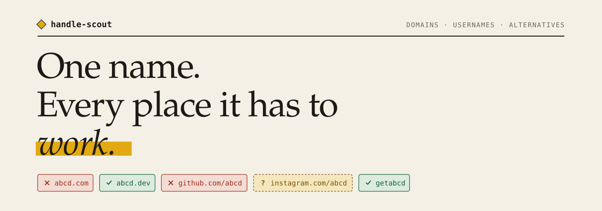
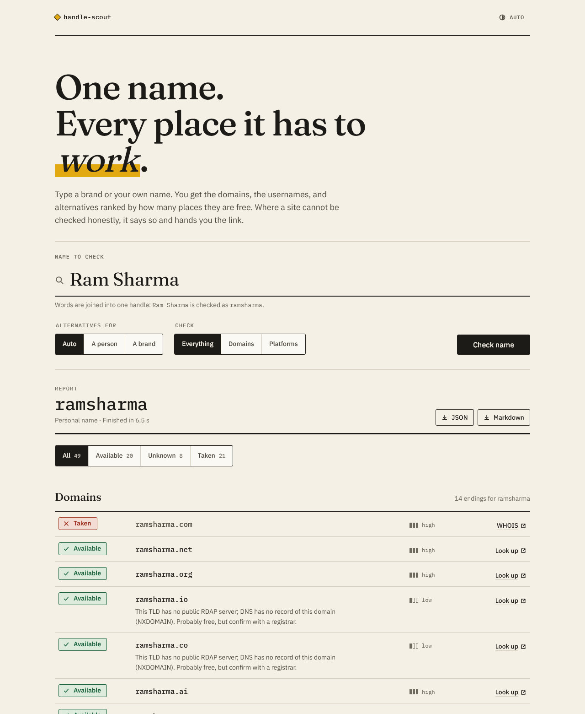
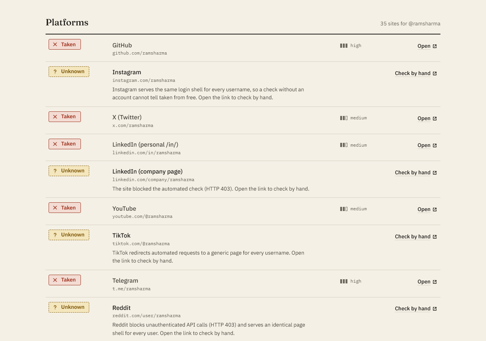
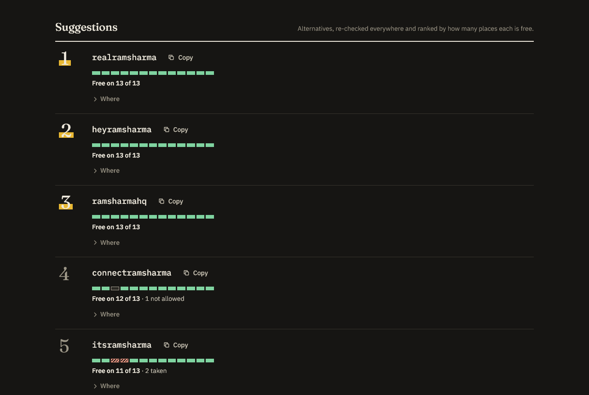
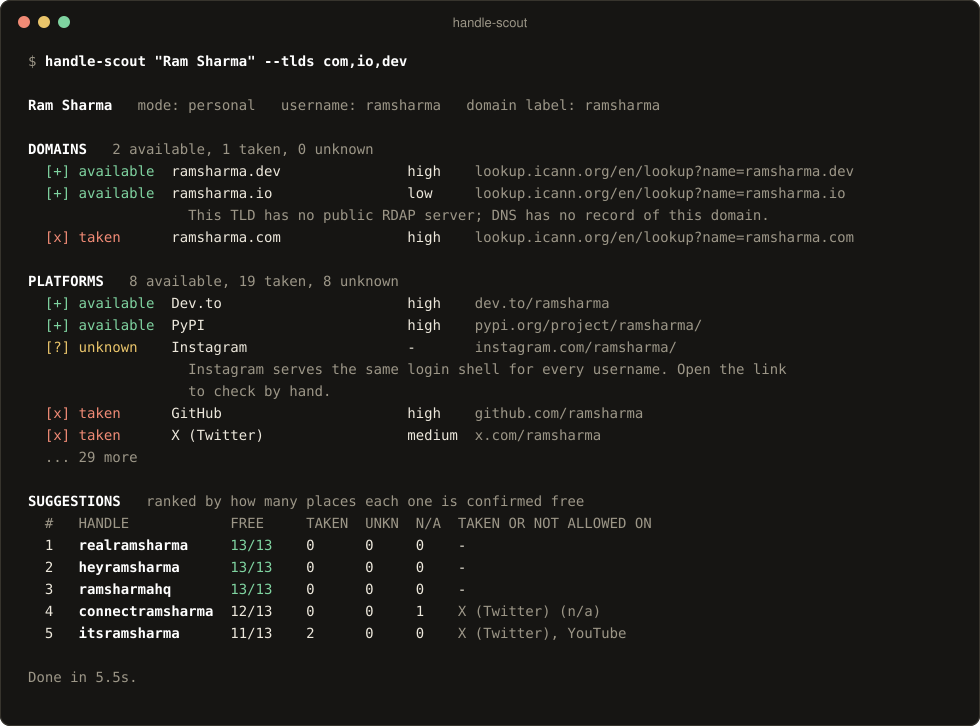
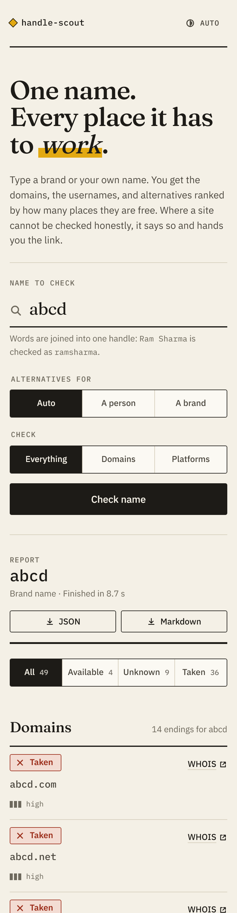
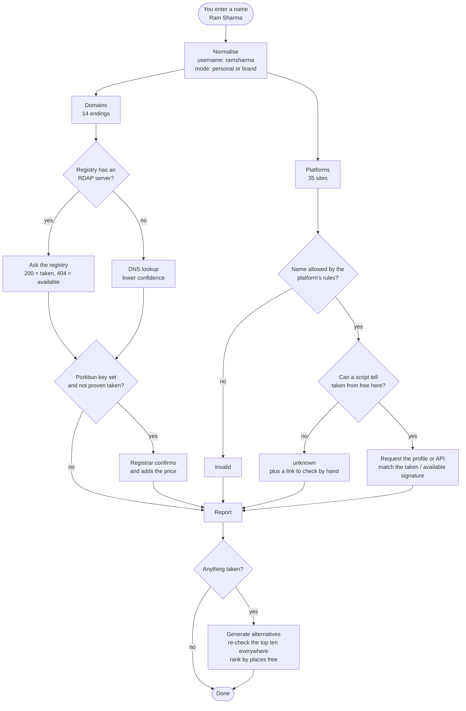

<p align="center">
  
</p>

<p align="center">
  <a href="LICENSE"></a>
  
  
  
  
  
  <a href="CONTRIBUTING.md"></a>
</p>

<p align="center">
  <b>Enter one name. Get one report:</b> which domains are free, which usernames are free,<br>
  and, where the name is taken, alternatives ranked by how many places they are free.
</p>

<p align="center">
  <a href="#quickstart">Quickstart</a> ·
  <a href="#what-it-checks">What it checks</a> ·
  <a href="#how-it-works">How it works</a> ·
  <a href="#porkbun-api-key-optional">Porkbun key</a> ·
  <a href="#adding-a-platform">Add a platform</a> ·
  <a href="#limitations">Limitations</a>
</p>

---

Launching a brand or a personal profile means checking the same name in forty places: the `.com`, the `.io`, GitHub, Instagram, X, LinkedIn, YouTube, npm, and on it goes. handle-scout does that in one run, from a web page or a terminal, and when the name is gone it tells you which variation is still free everywhere.

<p align="center">
  
</p>

## Contents

- [Why it exists](#why-it-exists)
- [Features](#features)
- [See it](#see-it)
- [How it works](#how-it-works)
- [The idea: four states, not two](#the-idea-four-states-not-two)
- [What it checks](#what-it-checks)
- [Quickstart](#quickstart)
- [Porkbun API key (optional)](#porkbun-api-key-optional)
- [As a library](#as-a-library)
- [Project layout](#project-layout)
- [Adding a platform](#adding-a-platform)
- [Limitations](#limitations)
- [Development](#development)
- [License](#license)

## Why it exists

Most username checkers answer "available" or "taken" for every site. Many of those answers are made up, because Instagram, TikTok, Facebook, LinkedIn and others return the same page to a script no matter what you ask.

handle-scout takes the opposite position: **an honest "I can't tell, here is the link" is worth more than a confident wrong answer.** Every platform's detector is tested against a handle known to be taken and a random string known to be free. A detector that cannot tell them apart is not allowed to answer.

## Features

| | |
| --- | --- |
| **Domains** | 14 endings checked against the registries' own lookup service (RDAP). No API key. |
| **Usernames** | 35 platforms: social, developer, writing and creator sites. |
| **Honest results** | Every result is `available`, `taken`, `unknown` or `invalid`, with a confidence level and a link to verify by hand. |
| **Ranked alternatives** | When the name is taken, variations such as `getabcd` or `iamramsharma` are re-checked everywhere and ranked by how many places each is free. |
| **Two modes** | *Personal* for a person's name, *brand* for a product or company. Picked automatically, or set it yourself. |
| **Prices (optional)** | Add a free Porkbun API key and available domains are confirmed by a registrar and shown with their price. |
| **Three ways to use it** | A web app, a command-line tool, and a TypeScript library, all on one engine. |
| **Exports** | JSON and Markdown reports, plus shareable links in the web app. |
| **Private** | Requests carry a generic browser identity and nothing about you. |

## See it

**Web app.** Results appear as each check finishes. Sites that cannot be checked by a script say why and hand you the link.

<p align="center">
  
</p>

**Ranked alternatives**, here in dark mode. Each bar is one place the alternative was checked.

<p align="center">
  
</p>

**Command line.** The same report in a terminal, readable without colour.

<p align="center">
  
</p>

<details>
<summary><b>On a phone</b></summary>
<br>
<p align="center">
  
</p>
</details>

## How it works



Every request runs under a global and a per-site concurrency limit, with a timeout, retries with backoff, and a ten-minute cache of definite answers.

## The idea: four states, not two

| State | Meaning |
| --- | --- |
| `available` | The site gave a response that only a free name produces. Comes with a confidence level. |
| `taken` | The site gave a response that only an existing account or registration produces. |
| `unknown` | The site cannot be checked reliably by a script. You get the reason and the direct link to check by hand. |
| `invalid` | The name breaks that platform's username rules (length, characters), so it cannot be registered there at all. |

A response that matches neither the "taken" nor the "available" signature (a bot wall, a rate limit, a redesigned page) is always `unknown`. Nothing is guessed.

## What it checks

**Domains** via [RDAP](https://about.rdap.org/), the registries' own free lookup protocol. No API key. The RDAP server for each TLD comes from the [IANA bootstrap file](https://data.iana.org/rdap/dns.json); HTTP 404 means available. Default TLDs: `.com .net .org .io .co .ai .app .dev .in .xyz .me .so .sh .tech`.

Some TLDs publish no RDAP server (at the time of writing: `.io .co .me .so .sh`). For those handle-scout falls back to a DNS lookup and marks the result lower-confidence: name servers found means registered (`medium`); NXDOMAIN means probably free (`low`).

**Optional: registrar confirmation and prices.** Add a free [Porkbun API key](#porkbun-api-key-optional) and every domain that is not already proven taken is confirmed by a registrar: you get a definite answer for the DNS-fallback TLDs, names a registry holds back are caught, and each available domain is shown with its price. Nothing changes if you skip this.

**Platforms.** Run `handle-scout --list-platforms` for the live list.

| How it is checked | Platforms |
| --- | --- |
| Automatic (available or taken) | GitHub, X/Twitter, YouTube, Telegram, Pinterest, npm (package), npm (scope/org), PyPI, Medium, Dev.to, Bluesky, Mastodon (mastodon.social), Docker Hub, GitLab, Bitbucket, Hugging Face, crates.io, RubyGems, Keybase, Linktree, Substack, Dribbble, Snapchat, SoundCloud, Patreon, Buy Me a Coffee |
| Taken-only (can confirm taken, otherwise unknown) | LinkedIn personal `/in/`, LinkedIn company page |
| Manual link (always unknown) | Instagram, TikTok, Reddit, Facebook, Threads, Twitch, Product Hunt |

**Suggestions**, when something is taken:

- personal (`Ram Sharma`): `iamramsharma`, `theramsharma`, `realramsharma`, `heyramsharma`, `ramsharmahq`, `connectramsharma`, `ram_sharma`, `ram.sharma`, `ram-sharma`, `rsharma`, `rams`, ...
- brand (`abcd`): `getabcd`, `tryabcd`, `useabcd`, `abcdhq`, `abcdapp`, `abcdio`, `joinabcd`, `withabcd`, `abcdlabs`, ...

The top ten are re-checked on `.com` and on every core platform that can be checked automatically, then ranked by the number of places each is free. Each platform's character rules apply, so `ram.sharma` counts as "not allowed" on GitHub rather than free.

## Quickstart

Requires Node.js 20.9 or newer (developed on Node 24, npm 11).

```sh
git clone https://github.com/devsharmagrowleads-oss/handle-scout.git
cd handle-scout
npm install
npm run build
```

### CLI

```sh
node packages/cli/dist/index.js abcd
node packages/cli/dist/index.js "Ram Sharma" --mode personal
node packages/cli/dist/index.js abcd --only domains
node packages/cli/dist/index.js acme globex initech --only socials     # bulk mode
node packages/cli/dist/index.js abcd --json > report.json
node packages/cli/dist/index.js abcd --md --out report.md
```

`npm run cli -- abcd` does the same. To get a real `handle-scout` command on your PATH, run `npm link -w handle-scout` once.

| Option | What it does |
| --- | --- |
| `--mode personal\|brand` | How alternatives are built. Default: personal when the name has spaces, otherwise brand. |
| `--only domains\|socials` | Check only domains, or only platforms. |
| `--tlds com,io,dev` | Which TLDs to check. |
| `--json` / `--md` | Print the report as JSON or Markdown. With several names, JSON is an array. |
| `--out <file>` | Write that output to a file. |
| `--file <path>` | Read names from a file, one per line. |
| `--no-suggestions`, `--suggestions <n>` | Skip alternatives, or change how many are ranked (default 10). |
| `--rank-all` | Rank alternatives across every automated platform, not only the core ones. |
| `--concurrency <n>`, `--timeout <ms>`, `--retries <n>` | Network behaviour. Defaults: 12, 10000, 2. |
| `--check-keys` | Test the Porkbun API key and exit. |
| `--no-registrar` | Ignore the Porkbun API key for this run. |
| `--list-platforms` | Show every platform and how it is checked. |

Output uses `[+]`, `[x]`, `[?]`, `[-]` plus a word, so it reads the same without colour and in any Windows console.

### Web app

```sh
npm run dev        # http://localhost:3000, rebuilds core first
# or, production:
npm run build
npm start
```

Checks run on the server through `GET /api/check?name=<name>&mode=auto|personal|brand&only=all|domains|socials` (browsers cannot make these requests themselves because of CORS). The response is newline-delimited JSON, one event per line, so results appear as each check finishes:

```
{"type":"plan", ...}                  what will be checked
{"type":"result","result":{...}}      one per domain / platform
{"type":"suggestions-plan", ...}
{"type":"suggestion-result", ...}
{"type":"done","report":{...}}        the full report
{"type":"export","markdown":"..."}    the same report as Markdown
```

The page has JSON and Markdown download buttons, and `/?q=some+name` runs a check on load so a result can be shared as a link.

## Porkbun API key (optional)

handle-scout works without any key. Adding a [Porkbun](https://porkbun.com) key makes the domain half of the report stronger:

| | Without a key | With a Porkbun key |
| --- | --- | --- |
| `.com .net .org .ai .app .dev .in .xyz .tech` | Registry lookup (RDAP), high confidence | Same, plus registrar confirmation and price |
| `.io .co .me .so .sh` | DNS guess, low confidence when "available" | Definite answer from the registrar, with price |
| Reserved or blocked names | Look available | Reported as taken |
| Price, first-year promo, renewal price, premium flag | Not shown | Shown |

The key is free. You need a Porkbun account, but you do not need to buy anything or add a payment method to check availability. handle-scout only calls Porkbun's read-only availability check; it never registers or changes anything.

### 1. Create the key

1. Create an account at [porkbun.com](https://porkbun.com) and sign in.
2. Open [porkbun.com/account/api](https://porkbun.com/account/api) (Account menu, then **API Access**).
3. Create a new API key. Give it a name you will recognise, such as `handle-scout`.
4. Under permissions, choose the **Read-only** preset. That is all handle-scout needs, and a read-only key cannot spend money or change your domains even if it leaks.
5. Copy both values straight away. The secret key is only shown once:
   - the **API key**, which starts with `pk1_`
   - the **secret key**, which starts with `sk1_`

### 2. Add it to handle-scout

In the handle-scout folder, copy `.env.example` to `.env` and fill in both values:

```sh
cp .env.example .env        # Windows PowerShell: Copy-Item .env.example .env
```

```
PORKBUN_API_KEY=pk1_your_key_here
PORKBUN_SECRET_API_KEY=sk1_your_secret_here
```

That one file is read by both the CLI and the web app. `.env` is in `.gitignore`, so it is not committed. If you would rather not use a file, set the same two variables in your shell or in your hosting provider's environment settings.

Reading `.env` needs Node 20.12 or newer. On older Node versions, set the variables in your shell.

### 3. Check that it works

```sh
node packages/cli/dist/index.js --check-keys
```

`Porkbun API key works` means you are done. Now run a check: available domains show a price column, and the report says how many were confirmed.

```
DOMAINS   3 available, 1 taken, 0 unknown
  STATE          DOMAIN     CONF    PRICE                              LINK
  [+] available  abcd.dev   high    $10.81/yr                          ...
  [+] available  abcd.io    high    $28.12 first year, then $46.07/yr  ...
  3 confirmed and priced by Porkbun. Prices are in US dollars and can change.
```

(The prices above are an illustration of the layout, not a quote.)

For the web app, restart `npm run dev` after adding the key. The key stays on the server and is never sent to the browser.

### How the key is used

- A domain the registry already shows as registered is not sent to Porkbun; there is nothing to add, and it saves your quota.
- Everything else (available, unknown, and the DNS-fallback TLDs) is sent in one bulk call of up to 25 domains.
- A full run checks at most 14 domains plus 10 alternatives. Porkbun's allowance is 200 domains a minute per account, so normal use stays far below it. Checking thousands of names for hours without registering any makes Porkbun throttle the account for a day.
- If Porkbun rejects the key, is rate-limited or does not answer, handle-scout keeps the free result and tells you why. A Porkbun failure never turns into a wrong answer.
- `--no-registrar` runs a check without using the key.

### If something goes wrong

| Message | What to do |
| --- | --- |
| `No Porkbun API key found` | The `.env` file is missing, is in a different folder from where you ran the command, or one of the two values is empty. |
| `Porkbun rejected the API key` | One of the values is wrong or was copied with a missing character. Create a new key and paste both values again. |
| `restricted to other IP addresses` | The key has an IP allowlist. Edit the key on Porkbun and add your address, or remove the restriction. |
| `rate limit was reached` | Wait the number of seconds shown and run it again. |

Other registrars can be added the same way: a provider is one object with a `check(domain)` function. See `packages/core/src/providers/porkbun.ts`.

## As a library

```ts
import { porkbunFromEnv, scout, toMarkdown } from '@handle-scout/core';

const report = await scout('Ram Sharma', {
  mode: 'personal',
  domainProvider: porkbunFromEnv(), // optional; undefined when no key is set
  onEvent: (event) => {
    if (event.type === 'result') console.log(event.result.name, event.result.state);
  },
});
console.log(toMarkdown(report));
```

## Project layout

```
packages/core   the engine: RDAP/DNS, platform detectors, suggestions, ranking, exports. No UI.
packages/cli    the handle-scout command
apps/web        Next.js (App Router) front end + streaming API route
```

Both front ends call the same `scout()` function.

Built in: a global and a per-host concurrency limit, per-check timeout, retries with exponential backoff on timeouts, HTTP 429 and 5xx, an in-memory cache (10 minutes; only definite answers are cached), and a generic browser User-Agent. No request carries anything about you: no contact address, no project name, no account.

## Adding a platform

A platform is one object in [`packages/core/src/platforms.ts`](packages/core/src/platforms.ts):

```ts
{
  id: 'example',
  name: 'Example',
  category: 'social',
  tier: 'extra',                       // 'core' also puts it in the suggestion ranking
  profileUrl: 'https://example.com/{handle}',
  rules: {
    minLength: 3,
    maxLength: 20,
    pattern: /^[a-z0-9_]+$/,           // tested against the lower-cased handle
    description: 'letters, digits and underscores; 3 to 20.',
  },
  detect: {
    type: 'http',
    url: 'https://example.com/api/users/{handle}',
    taken: { status: 200, bodyIncludes: '"id"' },
    available: { status: 404 },        // omit if the site can only confirm "taken"
  },
  confidence: 'high',
  probe: { taken: 'someone' },         // a handle you know exists
}
```

Then prove it works against the real site:

```sh
npm run verify:platforms -- example
```

That checks your known-taken handle and a random string. `PASS` means the detector told them apart. If it cannot, use `detect: { type: 'manual', reason: '...' }` instead; a manual link is better than a wrong answer. See [CONTRIBUTING.md](CONTRIBUTING.md).

## Limitations

Read these before you rely on a result.

- **"Available" is a hint, not a reservation.** Sites keep private lists of reserved, banned, trademarked and recently released names. Those look free from outside and are refused at sign-up. GitHub, YouTube, Telegram, Keybase and npm are all known to do this. The only proof is registering.
- **Seven platforms are never checked automatically**: Instagram, TikTok, Reddit, Facebook, Threads, Twitch and Product Hunt. They return the same response for every name, or a bot challenge. They always come back `unknown` with a link.
- **LinkedIn can only ever confirm "taken".** Public profiles sometimes load; everything else gets LinkedIn's HTTP 999/403 wall, which says nothing. handle-scout never reports a LinkedIn name as available.
- **Results depend on where you run it.** Detectors were verified from a residential connection. From a datacenter or shared IP, more sites will block requests and more rows will be `unknown`. That is the intended failure mode.
- **Telegram, Pinterest, Snapchat and Keybase "available" results are low confidence.** Telegram shows the same page for free names, private accounts and names sold on Fragment. Pinterest is detected from page text that can change.
- **X/Twitter**: suspended and deactivated accounts look free but cannot be registered. X changes its pages often; this detector is the most likely to break.
- **DNS-fallback TLDs** (`.io .co .me .so .sh`): without a Porkbun key, a registered domain with no name servers looks free. Add the key, or confirm with a registrar.
- **Domains can be premium-priced or registry-reserved** and still show as available when no Porkbun key is set. With the key, price and premium status are shown.
- **Prices are Porkbun's prices**, in US dollars, at the moment of the check. Other registrars charge differently, and a TLD Porkbun does not sell cannot be confirmed or priced.
- **Mastodon** is checked on mastodon.social only. **Bluesky** is checked for `<name>.bsky.social` only.
- **npm and PyPI** refuse names too similar to existing packages; that is only enforced when you publish.
- **Detectors rot.** Sites change. Run `npm run verify:platforms` to see which detectors still tell a taken handle from a free one, and please open an issue or PR when one fails.
- **No trademark check.** A free handle can still infringe someone's mark.
- **The web app is not hardened for public hosting.** The API route has a small in-memory rate limit (12 checks a minute per client address) and nothing else. If you set a Porkbun key on a public deployment, every visitor's checks draw on your account's allowance. Put a real rate limiter in front of it before exposing it to the internet, and read each site's terms of service: this tool makes ordinary unauthenticated page requests, at low volume, but you are responsible for how you run it.

## Development

```sh
npm test                    # unit tests for core (mocked HTTP and DNS; no network)
npm run typecheck
npm run build
npm run verify:platforms    # live check of every detector; needs network
```

## License

[MIT](LICENSE), copyright handle-scout contributors.
